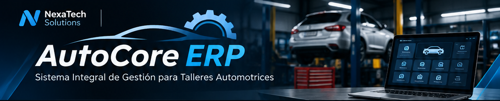
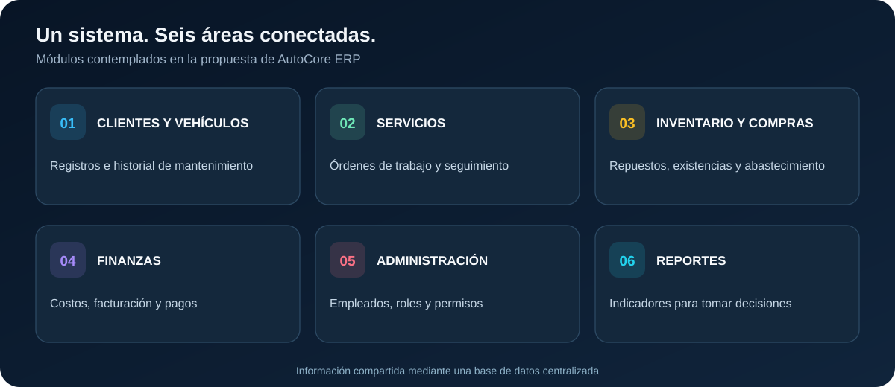
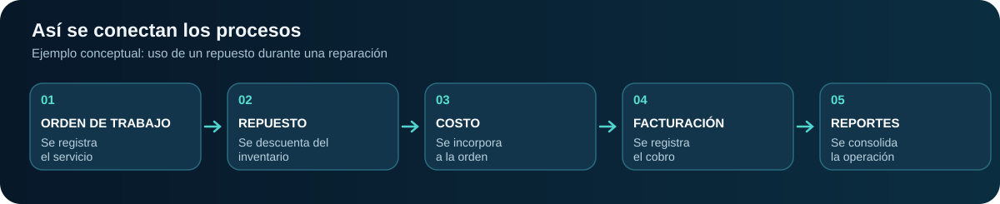

 

### Una plataforma. Todas las áreas de tu taller conectadas.

**Propuesta de un sistema de planificación de recursos empresariales para el sector automotriz.**

   

**[El proyecto](#-el-proyecto) · [Módulos](#-módulos-principales) · [Integración](#-cómo-se-conecta-todo) · [Alcance](#-alcance)**

---

## 🚘 El proyecto

**AutoCore ERP — Sistema Integral de Gestión para Talleres Automotrices** es una propuesta de desarrollo de software orientada a **integrar y automatizar los procesos administrativos, operativos y financieros** de un taller automotriz en una sola plataforma.

La idea surge ante una necesidad frecuente: la información de clientes, vehículos, reparaciones, repuestos y cobros puede estar repartida entre distintos registros o herramientas, lo que dificulta la coordinación y el seguimiento. AutoCore ERP propone **centralizar esa información** y permitir que las diferentes áreas trabajen con datos relacionados y actualizados.

Su diseño se plantea inicialmente para **una empresa del sector automotriz**, con la posibilidad de adaptarse en el futuro a otros talleres.

## 💡 ¿Qué queremos resolver?

En lugar de gestionar cada área por separado, AutoCore ERP busca conectar las operaciones del taller para atender cinco retos principales:

- **Coordinación entre áreas:** evitar que administración, operaciones e inventario trabajen con información aislada.
- **Seguimiento de reparaciones:** conocer el estado de las órdenes de trabajo y de los vehículos.
- **Control de repuestos:** reducir errores de registro y mantener actualizadas las existencias.
- **Gestión financiera:** vincular los servicios realizados con sus costos, facturas y pagos.
- **Información para decisiones:** reunir datos útiles para generar reportes gerenciales.

## 🧩 Módulos principales

Los siguientes seis módulos forman parte del **alcance funcional propuesto**:

  

Cada módulo tendrá una función específica, pero la propuesta es que **compartan información a través de una base de datos centralizada**. Se contempla una interfaz intuitiva y acceso según los roles y permisos de cada usuario.

## 🔗 ¿Cómo se conecta todo?

AutoCore ERP no se plantea únicamente como un programa para registrar reparaciones. Su valor como **ERP** está en relacionar los servicios con el inventario, las compras, la facturación, la administración y los reportes.

  

**Ejemplo:** cuando un mecánico utiliza un repuesto en una reparación, el sistema propuesto permitirá registrar su uso, **actualizar automáticamente el inventario** e **incorporar su costo a la orden de trabajo**. Después, esa información podrá utilizarse para la facturación y los reportes financieros.

Así, una sola operación aporta información a varias áreas sin necesidad de repetir el registro en diferentes sistemas.

## 🎯 Alcance

**Objetivo general:** proponer un sistema ERP que integre y automatice la gestión administrativa, operativa y financiera de un taller automotriz, mejorando la coordinación de procesos, el control de recursos y la disponibilidad de información para tomar decisiones.

**Alcance inicial:** un taller automotriz, seis módulos principales y datos compartidos entre las áreas. **Proyección:** adaptar la solución a otros talleres una vez definidas sus necesidades específicas.

> **Estado actual:** AutoCore ERP se encuentra en **fase de propuesta académica**. Los módulos y flujos mostrados representan el funcionamiento previsto; no son características que ya estén implementadas. Las tecnologías y la arquitectura definitiva se definirán en etapas posteriores.

---

**NexaTech Solutions**  
*Empresa propuesta para el desarrollo de AutoCore ERP*

**Diego Terán** · Pontificia Universidad Católica del Ecuador (PUCE) · 2026

AutoCore ERP — Del seguimiento de una reparación al control integral del taller.

