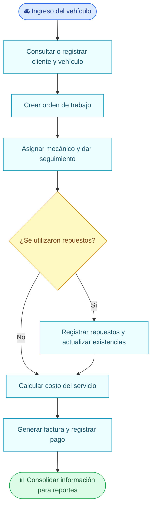
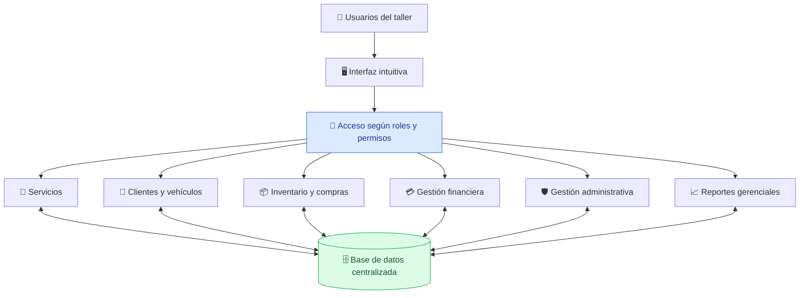

 

### 🚗 Una plataforma. Todas las áreas de tu taller conectadas.

**Propuesta de un sistema ERP para integrar la gestión administrativa, operativa y financiera de talleres automotrices.**

**[Descripción](#-descripción-del-proyecto) · [Problemática](#-problemática-identificada) · [Módulos](#-módulos-principales) · [Flujo](#-cómo-funcionaría-autocore-erp) · [Alcance](#-alcance-de-la-propuesta)**

---

## 📖 Descripción del proyecto

**AutoCore ERP — Sistema Integral de Gestión para Talleres Automotrices** es una propuesta de desarrollo de un sistema de **planificación de recursos empresariales (Enterprise Resource Planning, ERP)** orientado a integrar y automatizar los procesos administrativos, operativos y financieros de un taller automotriz.

El proyecto se diseñará **inicialmente para una empresa del sector automotriz**, con la posibilidad de adaptar la solución a otros talleres en el futuro. En lugar de manejar información aislada para reparaciones, repuestos, cobros o personal, AutoCore ERP propone conectar estos procesos en una **misma plataforma**, respaldada por una **base de datos centralizada**.

Su enfoque no es únicamente registrar servicios mecánicos: busca relacionar lo que ocurre en el taller con el uso de sus recursos, los costos de cada trabajo, los movimientos del inventario y la información que necesita la administración para tomar decisiones.

> 💡 **Nuestra idea:** que cada área del taller trabaje con información coherente, compartida y actualizada, evitando duplicar registros y facilitando el seguimiento de las operaciones.

## 🎯 Problemática identificada

En los talleres automotrices, el uso de registros manuales o herramientas independientes puede dificultar la comunicación entre áreas y el acceso oportuno a la información. La propuesta identifica cinco problemas principales:

| Problema | ¿Qué consecuencia puede generar? | ¿Qué plantea AutoCore ERP? |
| :-- | :-- | :-- |
| 🔀 **Falta de coordinación entre áreas** | Información dispersa entre administración, operaciones e inventario. | Integrar las áreas en un único sistema. |
| 🔧 **Dificultad de seguimiento de órdenes** | Poca visibilidad del estado de las reparaciones y los vehículos. | Gestionar órdenes de trabajo y el avance de servicios. |
| 📦 **Errores en el inventario** | Existencias desactualizadas y problemas al controlar repuestos. | Registrar movimientos y actualizar el inventario automáticamente. |
| 🧾 **Procesos manuales financieros** | Mayor dificultad para calcular costos, facturar y registrar ingresos. | Relacionar servicios, costos, facturación y pagos. |
| 📊 **Falta de datos consolidados** | Dificultad para generar reportes y respaldar decisiones. | Crear reportes con información de las diferentes áreas. |

## 💡 Solución propuesta

AutoCore ERP plantea **centralizar y conectar los procesos de un taller automotriz**. Una misma operación podrá aportar información a varios módulos sin requerir registros desconectados.

Los pilares de la propuesta son:

- **Integración:** comunicación entre servicios, inventario, finanzas y administración.
- **Automatización:** actualización de información relacionada, como las existencias de repuestos.
- **Trazabilidad:** seguimiento de vehículos, órdenes de trabajo y servicios realizados.
- **Control:** mejor organización de recursos, empleados y permisos de acceso.
- **Información para decidir:** reportes sobre ingresos, servicios y rendimiento operativo.

## 🧩 Módulos principales

La propuesta contempla **seis módulos** que compartirán información mediante una base de datos centralizada.

<table>
<tr>
<td width="50%" valign="top">

### 👤 01 · Clientes y vehículos

Registro de clientes, datos de sus vehículos e historial de mantenimiento. Permitirá consultar la información necesaria para nuevas atenciones.

</td>
<td width="50%" valign="top">

### 🔧 02 · Servicios y reparaciones

Creación de órdenes de trabajo, asignación de mecánicos y seguimiento del estado de las reparaciones.

</td>
</tr>
<tr>
<td valign="top">

### 📦 03 · Inventario y compras

Control de repuestos, actualización automática de existencias cuando corresponda y alertas de abastecimiento.

</td>
<td valign="top">

### 💳 04 · Gestión financiera

Cálculo de costos de los servicios, generación de facturas y registro de pagos.

</td>
</tr>
<tr>
<td valign="top">

### 🛡️ 05 · Gestión administrativa

Administración de empleados, definición de roles y permisos de acceso según las responsabilidades de cada usuario.

</td>
<td valign="top">

### 📈 06 · Reportes gerenciales

Visualización de ingresos, servicios realizados, utilización de repuestos y rendimiento operativo del taller.

</td>
</tr>
</table>

## 🔄 ¿Cómo funcionaría AutoCore ERP?

Este diagrama ilustra un **flujo conceptual** de atención y reparación; muestra el funcionamiento que se pretende alcanzar, no un sistema ya implementado.

### 🛠️ Ejemplo práctico: un repuesto conecta tres áreas

Supongamos que un mecánico utiliza un filtro durante una reparación:

1. **Servicios:** el repuesto se registra como parte de la orden de trabajo.
2. **Inventario:** el sistema actualiza automáticamente las existencias del filtro.
3. **Finanzas:** el costo del repuesto se agrega a la orden y posteriormente puede utilizarse para facturar.
4. **Reportes:** la operación aporta información al control de ingresos, repuestos utilizados y servicios realizados.

**Esta conexión entre áreas es la esencia de AutoCore ERP.**

## 🏗️ Integración propuesta del sistema

Se propone una **interfaz intuitiva**, controles de acceso de acuerdo con el rol del usuario y una **base de datos centralizada** que permita compartir información entre los módulos. **Las tecnologías, el diseño de base de datos y la arquitectura definitiva todavía no se han seleccionado**; se definirán durante el desarrollo del proyecto.

## ❓ ¿Por qué es un ERP y no solo un programa de reparaciones?

Un software enfocado únicamente en reparaciones puede registrar órdenes de trabajo y estados de vehículos. **AutoCore ERP va más allá en su propuesta:** conecta dichas órdenes con el inventario, las compras, los costos, la facturación, los pagos, la administración y los reportes.

| Sistema enfocado en reparaciones | AutoCore ERP (propuesta) |
| :-- | :-- |
| Gestiona principalmente los servicios mecánicos. | Integra procesos operativos, administrativos y financieros. |
| La información puede permanecer separada por área. | Plantea compartir información actualizada entre módulos. |
| Se concentra en el seguimiento de trabajos. | También relaciona el trabajo con repuestos, costos y reportes. |

Por esa **integración de recursos y procesos empresariales**, el proyecto se plantea como un sistema ERP.

## 🎯 Objetivos del proyecto

**Objetivo general:** Proponer y desarrollar un sistema ERP que integre y automatice la gestión administrativa, operativa y financiera de un taller automotriz, para mejorar la coordinación de procesos, el control de recursos y la disponibilidad de información para la toma de decisiones.

**Objetivos específicos:**

- Centralizar los datos de clientes, vehículos e historiales de mantenimiento.
- Facilitar la creación y el seguimiento de órdenes de trabajo.
- Mejorar el registro de repuestos, compras y existencias.
- Vincular los costos de reparación con la facturación y los pagos.
- Administrar empleados y permisos según el rol asignado.
- Ofrecer reportes que ayuden a evaluar la operación del taller.

## 🧭 Alcance de la propuesta

**Alcance inicial:** un taller automotriz, sus operaciones habituales y los seis módulos definidos en la propuesta.

**Proyección futura:** adaptar el sistema a otros talleres del sector automotriz, considerando sus necesidades particulares.

**Consideraciones actuales:** la propuesta define la necesidad, el enfoque y los módulos principales; aún no constituye un producto terminado ni establece funcionalidades implementadas, tecnologías específicas o fechas de entrega definitivas.

## 🗺️ Hoja de ruta orientativa

| Etapa | Qué contempla | Estado |
| :-- | :-- | :-- |
| **01. Propuesta** | Planteamiento del problema, solución y módulos. | ✅ Documentada |
| **02. Requerimientos** | Definición detallada de usuarios, reglas y funcionalidades. | ⏳ Pendiente |
| **03. Diseño** | Interfaces, modelo de datos y arquitectura técnica. | ⏳ Pendiente |
| **04. Construcción** | Desarrollo progresivo de funcionalidades e integración. | ⏳ Pendiente |
| **05. Pruebas** | Verificación de procesos, datos y experiencia de uso. | ⏳ Pendiente |

*La hoja de ruta es orientativa y podrá ajustarse según el alcance académico del proyecto.*

## 🏢 Empresa propuesta

**NexaTech Solutions** es el nombre de la empresa planteada para el proyecto. **AutoCore ERP** es el nombre de su solución de gestión para talleres automotrices.

## 👨‍💻 Autor y contexto académico

- **Autor de esta presentación:** Diego Terán.
- **Institución:** Pontificia Universidad Católica del Ecuador (PUCE).
- **Proyecto:** AutoCore ERP — Sistema Integral de Gestión para Talleres Automotrices.
- **Estado:** propuesta académica, 2026.

---

**AutoCore ERP** · *Del seguimiento de una reparación al control integral del taller.*

Propuesta académica · NexaTech Solutions · 2026

